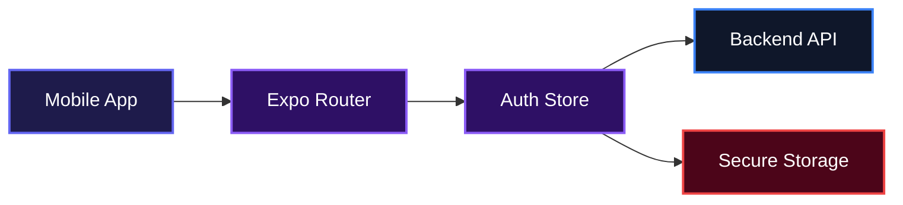
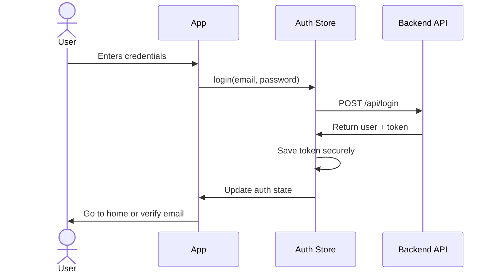
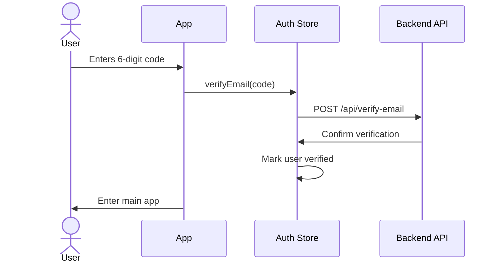

# App Starter Template

A production-ready starting point for cross-platform mobile apps that need authentication, protected navigation, and a polished user interface out of the box. This template handles login, signup, email verification, forgot password, and Google sign-in so developers can focus on building their actual product features instead of wiring up auth for the hundredth time.



## Features

- **Complete Authentication Flow**: Login, signup, email verification, forgot password, and Google sign-in screens are included and connected through a shared auth store.
- **Protected Routing**: Route guards automatically send unverified or logged-out users to the auth screens and verified users to the main app.
- **Secure Token Storage**: Tokens are stored in the device's secure keychain so sessions persist safely between app launches.
- **Animated Custom Tab Bar**: A polished bottom tab bar with smooth transitions and icon labels.
- **Theme System**: Design tokens for colors, spacing, radius, and typography keep the entire app visually consistent.
- **Keyboard-Aware Forms**: All auth screens handle software keyboards gracefully on both iOS and Android.
- **Type-Safe Codebase**: Full TypeScript coverage across screens, stores, and shared types.

### Authentication Flow

When a user logs in, the app validates input, talks to the backend, stores the session token, and routes the user to the right screen based on their verification status.



### Email Verification Flow

After registering, users who are not yet verified enter a 6-digit code. Once the backend confirms the code, the auth store marks the user as verified and the protected router pushes them into the main app.



## Installation

1. Clone the repository:

```bash
git clone https://github.com/BITMATES-ORG/APP-STARTER-TEMPLATE.git
cd APP-STARTER-TEMPLATE
```

2. Install dependencies:

```bash
npm install
```

3. Configure environment variables:

```bash
cp .env.example .env
```

Edit `.env` and set the required values:

```env
EXPO_PUBLIC_GOOGLE_WEB_CLIENT_ID=your_google_web_client_id
BACKEND_URL=https://your-api.example.com
```

4. Start the development server:

```bash
npm start
```

Then press `i` for iOS, `a` for Android, or `w` for web.

## Usage

Open the app and you'll land on the login screen. From there you can:

- Log in with an existing account
- Create a new account on the signup screen
- Reset a forgotten password
- Verify your email with a 6-digit code
- Sign in with Google

Once authenticated and verified, the app shows a three-tab layout with Home, Search, and Settings. The Settings tab displays the current user's profile and a logout button.

### Project Scripts

| Command                 | Description                           |
| ----------------------- | ------------------------------------- |
| `npm start`             | Start the Expo development server     |
| `npm run android`       | Run on an Android emulator or device  |
| `npm run ios`           | Run on an iOS simulator or device     |
| `npm run web`           | Run the app in the browser            |
| `npm run lint`          | Run ESLint with the Expo config       |
| `npm run reset-project` | Reset the project to a blank template |

## API Documentation

The app expects a REST API at the `BACKEND_URL` configured in your environment. Below are the endpoints used by the auth store.

#### POST /api/register

**Description**: Create a new user account.

**Request**:

```json
{
  "firstName": "Jane",
  "lastName": "Doe",
  "userName": "janedoe",
  "email": "jane@example.com",
  "password": "securepassword123"
}
```

**Response**:

```json
{
  "user": {
    "firstName": "Jane",
    "lastName": "Doe",
    "username": "janedoe",
    "email": "jane@example.com",
    "isVerified": false,
    "createdAt": "2025-01-01T00:00:00.000Z"
  },
  "token": "eyJhbGciOiJIUzI1NiIsInR5cCI6IkpXVCJ9..."
}
```

**Errors**:

- 400: Validation failed or account already exists
- 500: Server error

#### POST /api/login

**Description**: Authenticate an existing user.

**Request**:

```json
{
  "email": "jane@example.com",
  "password": "securepassword123"
}
```

**Response**:

```json
{
  "user": { "...": "..." },
  "token": "eyJhbGciOiJIUzI1NiIsInR5cCI6IkpXVCJ9..."
}
```

**Errors**:

- 400: Missing fields
- 401: Invalid credentials
- 500: Server error

#### GET /api/me

**Description**: Fetch the currently authenticated user.

**Authentication**: Required. Pass `Authorization: Bearer {token}`.

**Response**:

```json
{
  "user": { "...": "..." }
}
```

**Errors**:

- 401: Missing or invalid token
- 403: Token expired or revoked

#### POST /api/verify-email

**Description**: Verify a user's email address with a 6-digit code.

**Request**:

```json
{
  "code": "123456"
}
```

**Response**:

```json
{
  "success": true
}
```

**Errors**:

- 400: Invalid or expired code
- 401: Unauthorized

#### POST /google/login

**Description**: Authenticate or register a user after a successful Google sign-in.

**Request**:

```json
{
  "googleUser": { "...": "..." },
  "idToken": "google_id_token"
}
```

**Response**:

```json
{
  "user": { "...": "..." },
  "token": "eyJhbGciOiJIUzI1NiIsInR5cCI6IkpXVCJ9..."
}
```

**Errors**:

- 400: Invalid Google token
- 500: Server error

### Environment Variables

| Variable                           | Required | Description                             |
| ---------------------------------- | -------- | --------------------------------------- |
| `BACKEND_URL`                      | Yes      | Base URL of the backend API             |
| `EXPO_PUBLIC_GOOGLE_WEB_CLIENT_ID` | Yes      | Google Web Client ID for Google Sign-In |

## Technologies Used

| Technology                                                                     | Description                                        |
| ------------------------------------------------------------------------------ | -------------------------------------------------- |
| [TypeScript](https://www.typescriptlang.org/)                                  | Typed JavaScript for safer, more maintainable code |
| [Expo](https://expo.dev/)                                                      | Cross-platform mobile development framework        |
| [React Native](https://reactnative.dev/)                                       | Native mobile UI library                           |
| [Expo Router](https://expo.dev/router)                                         | File-based routing for React Native                |
| [Zustand](https://zustand.docs.pm/)                                            | Lightweight state management                       |
| [React Native Reanimated](https://docs.swmansion.com/react-native-reanimated/) | Smooth animations and transitions                  |
| [expo-secure-store](https://docs.expo.dev/versions/latest/sdk/secure-store/)   | Secure local token storage                         |
| [Google Sign-In](https://react-native-google-signin.github.io/)                | Social authentication                              |

## Contributing

Contributions are welcome. If you find a bug or have an idea for an improvement, open an issue or submit a pull request. Please keep changes focused and follow the existing code style.

## Author

Built with care for developers who want to ship faster.

<br>

[](https://www.typescriptlang.org/)
[](https://reactnative.dev/)
[](https://expo.dev/)
[](https://zustand.docs.pm/)
